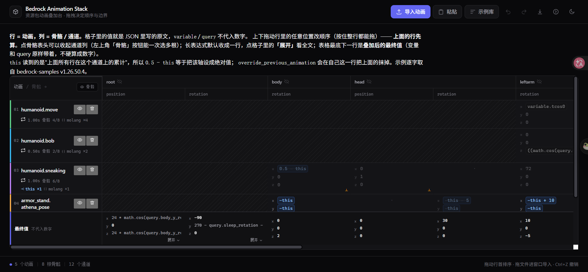

# Bedrock Animation Stack

> 把 Minecraft 基岩版资源包里的动画 JSON 摊成一张表：**行 = 一段动画**，**列 = 骨骼 → 通道**，格子里是**原文**（`variable.*` / `query.*` / `this` 一律不代入数字）。



## 它是干什么的

动画 JSON 里的 `override_previous_animation` 和 `this` 到底谁盖谁，光看代码很难说清——尤其是好几段动画叠在一起的时候。这个页面把叠加过程摆平：

- **行序即求值顺序**：上面的行先算，下面的后叠；拖行首的抓手（或聚焦后按 `↑` `↓`）就能改顺序，改完立刻能看到哪些格子被作废。
- **`override_previous_animation`**：行顶一条琥珀色横线，说明带标出「它碰到的骨骼，上面的累计到这里切断」，上面被抹掉的格子划掉并标 `⟂`。
- **`this`**：值表达式里代表「这个通道在它上面所有行的累计」。凡是原文里出现 `this` 的那一条轴，会标成蓝色——只有那一条轴，不是整格。
- **变量占位符**：顶栏的「变量」按钮里给 `variable.*` / `query.*` 填值，底部的「最终值」行就把能算的算成数字；输入框可以**按住左右拖**来调（1px = 1，`Shift` ×10，`Alt` ×0.1），手停就停。
- **示例库**：内置 `bedrock-samples v1.26.50.4` 的真实动画，含 FMBE（`wiki.bedrock.dev/commands/display-entities`）用到的那批原版载体动画；勾选即入栈。

## 怎么用

单文件、零依赖、零 CDN——**直接双击 `index.html`** 就能用。

想跑本地服务（避免个别浏览器对 `file://` 的限制）：

```bash
node server.js        # -> http://127.0.0.1:8765/index.html
```

支持的输入：`.json` 文件、整个文件夹拖进窗口、直接粘贴文本。带 `//` 注释的 JSON 也能读（原版包里就有 6 个这样的文件）。

## 文件

| 文件 | 说明 |
| --- | --- |
| `index.html` | 全部交付物（HTML + CSS + JS 内联） |
| `HANDOVER.md` | 完整接手指南：语义规则、代码地图、已知问题、变更记录 |
| `server.js` | 极简静态服务（8765，`no-store`） |
| `preview.png` / `samples.png` / `vars.png` / `compare-override.png` | 截图 |
| `_v1-viewer.html` | 最早那版 3D 预览器，仅留作参照 |

## 语义速查

| 通道 | 叠加方式 |
| --- | --- |
| `position` / `rotation` | 逐轴相加，基准 0 |
| `scale` | 逐轴相乘，基准 1 |

`this` 读的是**它上面所有行**在该通道上的累计，所以 `"0.5 - this"` 得到的是绝对值 `0.5`，`"-this"` 把这一轴清零。

更多细节（含 12 条「看起来是 bug 其实是语义」的坑）见 [HANDOVER.md](HANDOVER.md) §5。
